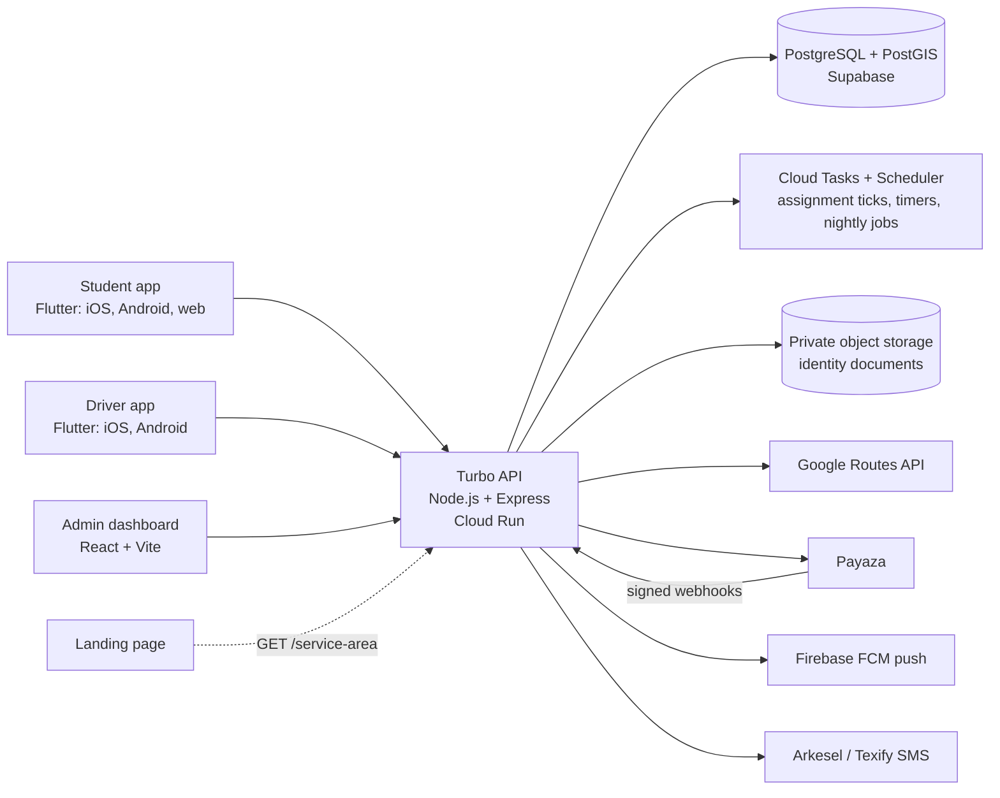

# 02. Architecture

## Principles

1. **The server decides.** Eligibility, fare, ride state and money are computed only by the API. Apps display and request; they never calculate a fare.
2. **Contract first.** `api/openapi.yaml` is the interface. Apps and dashboard are generated and mocked from it.
3. **Boring and cheap.** Three developers, campus-scale traffic. Prefer polling, one database, one queue. Add complexity only when a number demands it.
4. **Money is a ledger.** Append-only entries, integer pesewas, row locks, idempotency keys.

## Components



## Stack

| Layer | Choice | Note |
| --- | --- | --- |
| Student and driver apps | Flutter, Riverpod, GoRouter | Student app also builds for web |
| Admin dashboard | React + Vite, TypeScript | Types generated from the contract |
| Landing page | Static site on Vercel | Emmanuel's choice of framework |
| API | Node.js + Express, TypeScript | Reuse `@bevingh` primitives where they fit: pesewa helpers, cursor pagination, RFC 9457 errors, idempotency, ledger locking |
| Database | PostgreSQL (Supabase) with PostGIS | Boundary check is `ST_Contains`; nearest driver is `ST_Distance` |
| Timers and jobs | Cloud Tasks and Cloud Scheduler | Assignment ticks, acknowledgement and search timeouts, nightly jobs. **No Redis in v1** (see Cost shape) |
| Push | Firebase Cloud Messaging | |
| SMS | Arkesel or Texify | One-time codes, invitations, trip-share links |
| Payments | Provider adapter; first adapter is **Payaza** (mobile money collections) | See D2, D18 and `08-payaza-integration.md` |
| Hosting | Cloud Run (API), Vercel (dashboard, landing) | Cloud Run scales to zero; see Cost shape |

## Realtime: polling first

| Need | v1 approach | Why |
| --- | --- | --- |
| Driver position on student map | Driver app `PUT /driver/location` every 5 s. Student app polls `GET /rides/{id}/tracking` every 5 s during an active ride | No sockets to keep alive on Cloud Run, trivial to mock, plenty for a campus |
| Ride status changes | FCM push plus the same polling | Push can be missed; polling is the safety net |
| Admin live map | `GET /admin/rides/live` every 5 s | Same |

If polling cost or lag becomes a problem after the pilot, add Server-Sent Events on the same endpoints. The contract does not change.

Location writes upsert one row per driver in an **UNLOGGED** `driver_presence` table (latest point and `seen_at`; losing it in a crash is harmless). Postgres history gets a sample (every 30 s, and every point during an active ride) for disputes. Do not append every point to the history table.

## Authentication

- Students and drivers: phone number plus a 6-digit SMS code (5 min life, 3 attempts, rate limited per number and per IP).
- Staff: email and password, with optional TOTP that must be on for `super_admin` and `finance`.
- Access token: JWT, 15 minutes. Refresh token: 30 days, rotating, stored hashed; reuse of an old token revokes the session.
- Web clients (dashboard, student web) keep the refresh token in an **httpOnly, Secure cookie**. Mobile clients keep it in secure storage and send it in the body.
- Cookies need the app and API on the same site, for example `app.<domain>` and `api.<domain>`. Decide domains early.
- Drivers cannot self-register: an admin creates them and they receive an SMS invitation.

## Service area and quotes

1. App sends pickup and drop-off to `POST /rides/quote`.
2. API checks both points against the boundary polygon (PostGIS), then calls the Routes API for **road** distance and duration.
3. Distance above the limit, a point outside the boundary, an unverified student, an existing active ride, or no drivers on duty gives `eligible:false` with plain-language reasons.
4. Otherwise the fare comes from the fare bands, the quote is stored with a 5-minute expiry, and the fare is locked for that quote.

Cost control for Routes API calls: cache by rounded coordinate pair, precompute distances from fixed pickup points to common destinations, and never call it for points already outside the boundary.

## Assignment engine

A **task-driven loop on Cloud Tasks**, started when a ride is created. There is no always-on worker: Cloud Run only gives CPU to code that is handling a request, so timers inside the process would silently stop.

```
ride created (status = searching, fare held)
task assign(ride) runs, and re-enqueues itself 5 s later, until assigned or noDriverTimeoutSeconds (default 300) passes:
    candidates = drivers that are
        on duty AND active AND vehicle active
        AND have no ride in (assigned, driver_arrived, in_progress)
        AND last location is under 60 s old
        AND not in this ride's declined list
    pick the nearest to the pickup point (straight-line)
    in ONE transaction:
        lock the driver row (FOR UPDATE SKIP LOCKED)
        re-check the driver has no active ride
        set ride.driver, ride.status = assigned
    push to driver and student
if the driver does not acknowledge within driverAckTimeoutSeconds (default 45):
    add them to the declined list (reason ack_timeout), status back to searching
if the deadline passes:
    cancel (by system, no_driver_available), release the hold, tell the student
```

**Safeguard against double assignment** is the database, not the code: a partial unique index allows at most one ride per driver in an active status.
Two workers racing for the same driver get a constraint error and move to the next candidate.

Admins can reassign manually at any time before the trip starts. A manual reassignment writes a ride event and an audit entry.

## Money safety

| Rule | Mechanism |
| --- | --- |
| No floats | Integer pesewas everywhere, including the contract |
| No double spend | Every wallet change locks the wallet row (`SELECT ... FOR UPDATE`) in the same transaction as the ledger insert |
| No double credit | Webhook events de-duplicated by unique `(provider, reference)`; signature verified before anything else |
| No double charge on retry | `Idempotency-Key` required on booking, top-up, refund, adjustment, salary record |
| No client-side trust | The wallet is credited only by a verified webhook or a staff adjustment, never by the app saying "I paid" |
| Auditability | Ledger and ride events are append-only. Corrections are new entries |
| Reconciliation | Daily job compares provider records with `succeeded` top-ups and flags differences for the finance role |

Flow: **hold** the fare at booking, **charge** the held amount at completion, **release** on cancellation. Fare is locked at the quote, so the charge equals the hold.

## Identity documents

- Private bucket, no public URLs. Uploads use short-lived signed PUT URLs; staff views use signed GET URLs valid for minutes.
- Every document view is written to the audit log with the staff id.
- Encryption at rest (provider default) and TLS everywhere. Only the `verifier` and `super_admin` roles can view.
- A scheduled job purges documents after the retention period (D5). The decision record stays, the images do not.

## Cost shape

Spending starts at go-live; development and staging run on free plans.

| Choice | Why |
| --- | --- |
| Cloud Run **request-based billing, min instances 0** | At pilot size this is about US$5 to US$18 a month. At Growth size (about 38 requests a second at peak) it is about US$40, and an always-on instance (about US$47 to US$53) becomes the better deal: flip the setting, no code change |
| **No Redis in v1** | Presence lives in an UNLOGGED Postgres table; timers live in Cloud Tasks. Saves US$10 a month and one moving part. Revisit if presence writes ever stress the database |
| Supabase **Pro for production** | Free plan has no backups, no point-in-time recovery, pauses after a week of inactivity, 500 MB database. Not acceptable for a wallet ledger. Free plans are fine for dev and staging |
| Cloud Tasks and Scheduler | Cloud Tasks: first 1M operations a month free. Cloud Scheduler: 3 free jobs, then US$0.10 each |

Cold start: after a quiet period the first request can take a second or two longer. While drivers are on duty their pings keep an instance warm.

**Rules this imposes on the API code** (see `07-repos-and-conventions.md`): no `setInterval` or background loops; every timer is a Cloud Task; every task handler is idempotent (Cloud Tasks delivers at least once); task names are deterministic (ride id plus attempt) so duplicates are dropped.

## Observability

Structured JSON logs with a request id, error tracking, and a `/health` endpoint. Bevin's own logging and metrics service can receive logs and health pings.
Alerts to set up before the pilot: failed webhooks, rides stuck in `searching` over 3 minutes, wallet reconciliation differences, SOS incidents unacknowledged for 2 minutes.

## Environments

`local` (mock or Docker Postgres), `staging`, `production`. Local and staging use free plans; only production is paid. Separate Supabase projects, separate payment-provider keys (sandbox on staging), separate Firebase projects. Secrets live in the cloud secret manager, never in a repo.
