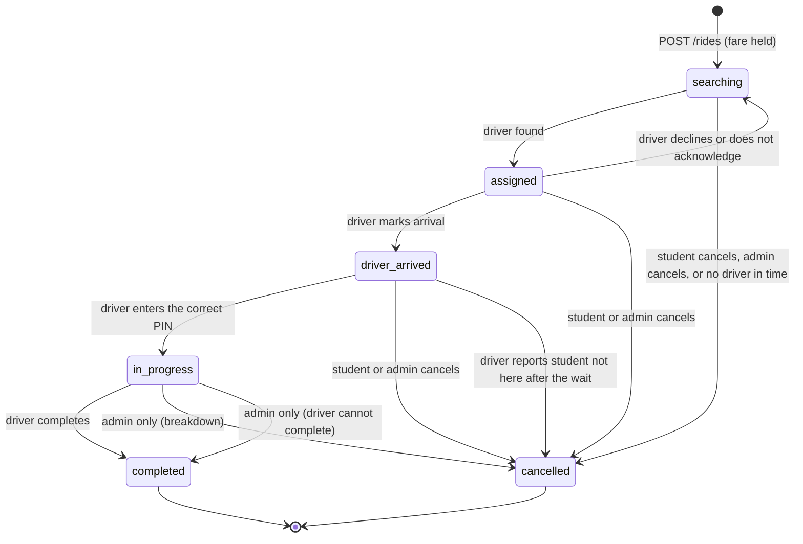
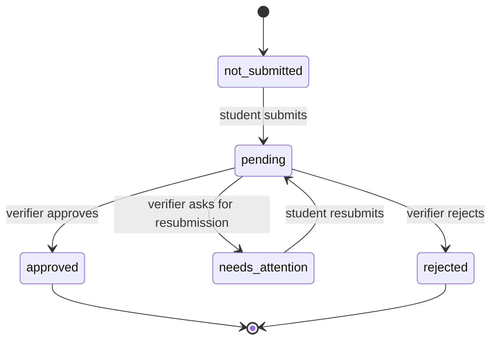
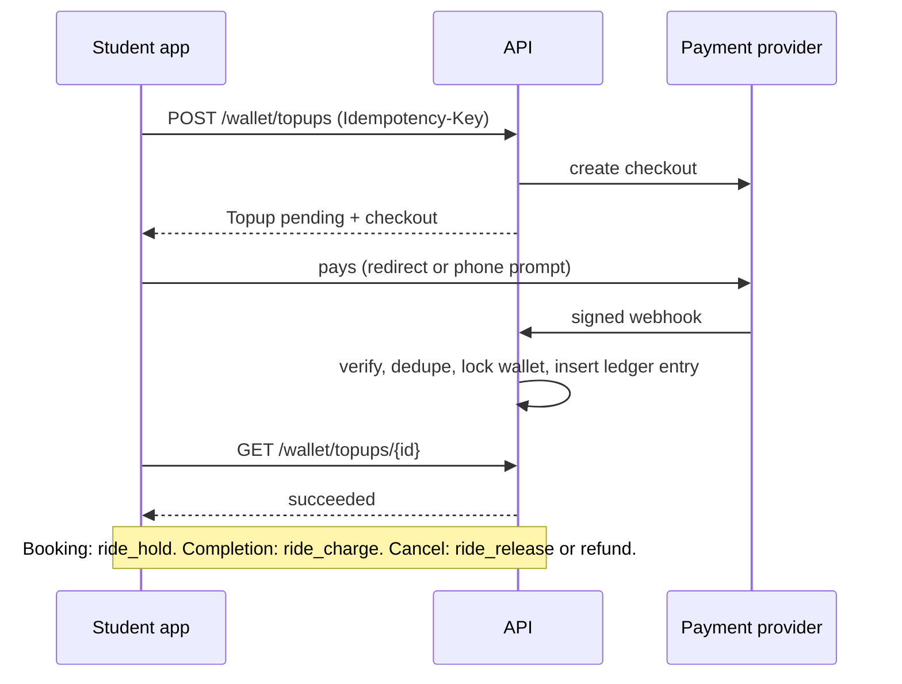

# 03. Domain and state machines

## Entities

All tables use UUID ids, `created_at`, `updated_at`, and **soft delete** (`deleted_at`). The exceptions are append-only tables (marked ◆), which are never updated or deleted.

| Area | Tables |
| --- | --- |
| Identity | `users`, `students`, `drivers`, `staff_users`, `devices`, `otp_challenges`, `refresh_tokens` |
| Verification | `verifications`, `verification_decisions` ◆, `uploads` |
| Fleet | `vehicles`, `driver_documents`, `driver_presence` (UNLOGGED, latest point per driver), `driver_locations` (sampled history) |
| Config | `service_area` (versioned), `pickup_points`, `fare_bands`, `settings` |
| Rides | `quotes`, `rides`, `ride_events` ◆, `ride_declines` ◆ |
| Money | `wallets`, `ledger_entries` ◆, `holds`, `topups`, `provider_events` ◆ |
| Safety and support | `trusted_contacts`, `trip_shares`, `incidents`, `support_tickets`, `support_messages` |
| Operations | `shifts`, `attendance`, `salary_profiles`, `salary_payments`, `audit_log` ◆ |
| Plumbing | `idempotency_keys`, `saved_places` |

## Ride lifecycle

| Transition | Who | Money |
| --- | --- | --- |
| → searching | student | Fare **held** |
| searching/assigned/driver_arrived → cancelled | student, admin, system | Hold **released** |
| assigned → searching (decline, ack timeout) | driver, system | No change; hold stays |
| in_progress → completed | driver | Hold becomes a **charge** |
| driver_arrived → cancelled (`rider_no_show`) | driver, after `noShowWaitSeconds` | Hold **released**, no fee |
| in_progress → completed (forced) | admin, with reason | Hold becomes a **charge** |
| in_progress → cancelled | admin | Charge or release, plus any **refund** (D13) |

Notes:

- A student cannot cancel once the trip is in progress (they are in the car). Staff handle breakdowns.
- **Stuck rides.** A Cloud Task per active ride checks the driver's last ping. No ping for `driverSilenceSeconds` sets the `driver_unreachable` flag and alerts dispatch; an in-progress ride over twice its expected duration gets `overdue`. Nothing is cancelled automatically: a person decides (force-complete or cancel).
- Completion far from the destination or under a minute sets `completed_far_from_destination` or `completed_too_fast` for review. It never blocks completion.
- Declines and timeouts are recorded in `ride_declines` and excluded from re-matching for that ride.
- Every transition writes a `ride_events` row with actor and time. The admin ride page renders these as the timeline.

## Invariants (enforced in the database where possible)

1. A student has at most one ride in an active status.
2. A driver has at most one ride in an active status (partial unique index).
3. A hold exists if and only if the ride is `searching`, `assigned`, `driver_arrived` or `in_progress`.
4. `wallet.balance >= wallet.reserved >= 0` (check constraint).
5. `balance` equals the sum of ledger entries that affect balance. `reserved` equals the sum of open holds. A nightly job asserts both.
6. A ride has a start PIN only while it can still be started; the PIN is never sent to the driver app.
7. Ledger, ride events, decisions and audit entries are never updated or deleted.

## Verification lifecycle

Only `approved` students can get a quote or book. `rejected` is final for that account; Turbo staff can reopen it manually.
Each decision creates an immutable `verification_decisions` row and notifies the student by push and SMS.

## Wallet lifecycle

Ledger entry types: `topup`, `ride_hold` and `ride_release` (no balance effect, they move money between available and reserved), `ride_charge`, `refund`, `adjustment`, `provider_reversal` (the network reversed a top-up; may take the wallet negative, shown as `owedPesewas`, and blocks booking with `account_owes` until topped up).

## Driver duty and attendance

`off_duty` → `on_duty` writes a clock-in; the reverse writes a clock-out. A driver cannot go off duty during an active ride.
Attendance rows are derived from clock events falling inside a scheduled shift (D11); staff corrections create a new value and keep the old one in the audit log.
